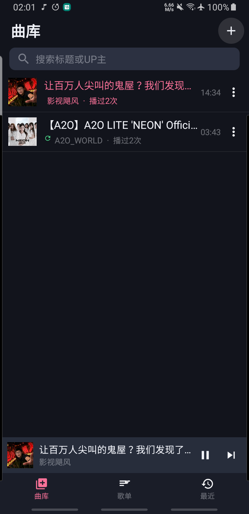
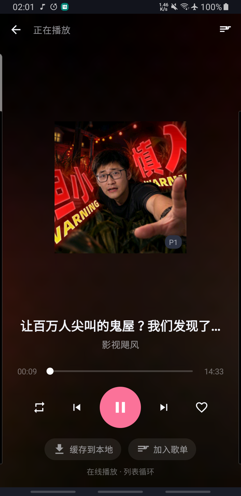
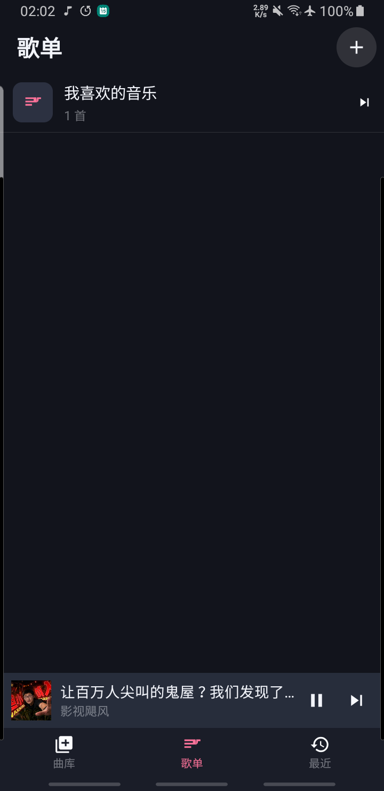
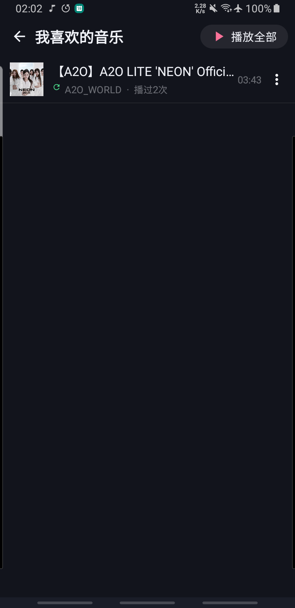
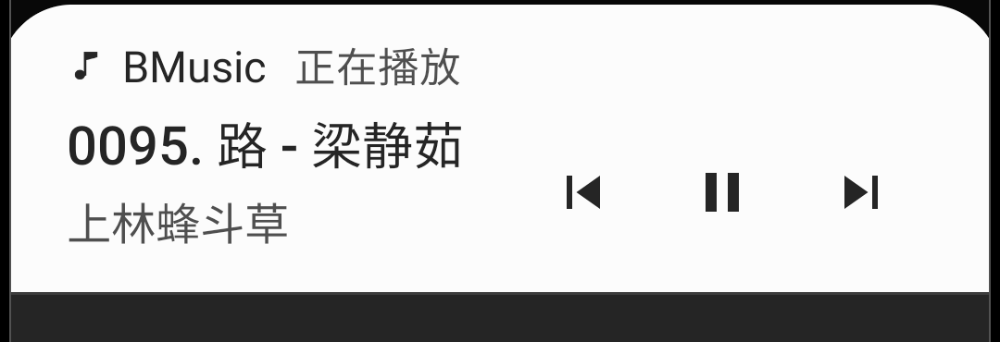
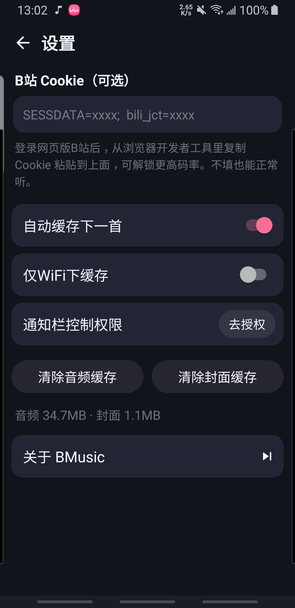

# 🎵 BMusic

> **把 B 站视频当音乐听。** 分享链接 → 自动解析 → 后台播放 / 离线缓存，像用音乐 App 一样用 B 站。

<p>
  
  
  
  
  
</p>

BMusic 是一个**零第三方依赖、不依赖 Gradle** 的原生 Android 音乐播放器。它不下载视频，而是直接从 B 站取出**纯音频流**（DASH 音轨），配上完整的播放列表、后台播放、通知栏控制、离线缓存和播放器界面，让 B 站的视频内容也能被"当歌听"。

整个 App 从界面、网络、播放、缓存到数据库全部手写，APK 只有 **约 140 KB**。

---

## 📸 界面预览

| 曲库 | 播放页 | 歌单 |
| :---: | :---: | :---: |
|  |  |  |
| 搜索 / 缓存标记 / 迷你播放条 | 模糊封面背景 · 进度拖拽 · 三种播放模式 | 自建歌单 + 内置「我喜欢的音乐」 |

| 歌单详情 | 通知栏控制 | 设置 |
| :---: | :---: | :---: |
|  |  |  |
| 播放全部 / 排序 / 移除 | 上一首 · 暂停 · 下一首 | Cookie / 缓存策略 / 空间管理 |

---

## ✨ 功能亮点

### 🎧 像音乐软件一样用 B 站
- **分享即添加**：在 B 站 App / 网页点「分享」→ 选择 BMusic；或复制整段分享文案，回到「曲库」页点右上角 `+` 粘贴即可
- **智能识别**：自动从任意文本里提取 `BV 号` / `av 号` / `b23.tv 短链` / 完整链接，还会自动跟随短链跳转
- **多 P 精确**：多 P 视频按「分 P」精确取对应音轨，标题显示分 P 名（如 `P3 · 演唱会现场`）

### 🎵 完整的播放器体验
- **后台播放**：前台服务常驻，锁屏、切到别的 App、息屏都不断
- **通知栏 / 耳机控制**：MediaStyle 通知条（上一首 / 暂停 / 下一首），蓝牙耳机与线控按键可用
- **三种播放模式**：列表循环 · 单曲循环 · 随机播放
- **播放队列**：独立队列页，标记正在播放的曲目，支持上移 / 下移 / 移除 / 立即播放等操作
- **批量导入**：曲库一键把当前筛选范围全部导入队列并播放，不打断正在听的歌
- **迷你条状态**：缓冲中 / 播放中 / 已暂停实时呈现，标题切换带过渡动画
- **在线歌词**：自动匹配歌词逐行高亮，也可手动搜索切换

### 📼 离线缓存，断网也能听
- **一键缓存**：把音频存到本地，之后播放**本地优先**，不再依赖网络
- **自动缓存下一首**：边听边把下一首备好（可限制仅 WiFi 下缓存）
- **空间管理**：「我的」页实时显示音频 / 封面缓存占用，可一键清理

### 📚 图书馆式管理
- **歌单体系**：自建歌单 + 内置「我喜欢的音乐」，支持加入 / 移除 / 上下排序 / 重命名 / 清空
- **播放历史**：最近播放 + 每首歌的播放次数统计
- **本地搜索**：按标题 / UP 主 / BV 号过滤曲库

---

## 🚀 快速开始

### 方式一：直接用 APK

```bash
adb install -r bmusic.apk
```

> APK 用调试证书签名，直接安装即可；系统会提示"未知来源"，允许后继续。

### 方式二：从源码构建

只需 **Android SDK（build-tools 34 + platform android-34）** 和 **JDK 17**，**不需要 Gradle、不需要联网下载依赖**：

```bash
git clone https://github.com/volcanochen/bmusic.git
cd bmusic
bash build.sh          # 产出 build/bmusic.apk
adb install -r build/bmusic.apk
```

`build.sh` 会在首次运行时自动生成 `debug.keystore` 并完成 **资源编译 → 链接 → 编 Java → 打 dex → 对齐 → 签名** 全流程。

---

## 📖 使用指南

| 步骤 | 操作 |
| --- | --- |
| **加歌 ①** | B 站 App 里点分享 → 选 **BMusic** |
| **加歌 ②** | 复制分享文案 → 打开 BMusic「曲库」→ 点 `+` → 自动填入剪贴板 → 解析添加 |
| **播放** | 点曲目即播；底部迷你条可暂停 / 切歌；点迷你条进播放页 |
| **管理** | 曲目右侧 `⋮`（或长按）：立即播放 / 加入队列 / 缓存 / 加歌单 / 删除 |
| **队列** | 播放页底部「播放队列」进队列页：正在播放带 ▶，可上移 / 下移 / 移除 / 立即播放 |
| **批量播放** | 曲库右上「播放 N 首」：把当前筛选范围全部导入队列并播放 |
| **歌词** | 播放页「歌词」打开歌词面板，自动搜索匹配，可手动搜索切换 |
| **离线** | 播放页点「缓存到本地」，或设置里开「自动缓存下一首」 |

### 关于音质与 Cookie

不填 Cookie 也能正常取流（通常 64K / 132K）。在「设置」里粘贴网页版 B 站的 `SESSDATA` 等 Cookie 后，可解锁更高码率（**192K**）。

```text
登录 bilibili.com → F12 开发者工具 → Network → 复制任意请求的 Cookie
→ 粘贴到 BMusic 设置页
```

---

## ❓ 常见问题

**Q：为什么不直接下载视频？**
A：音乐播放只需要音轨。BMusic 走 `playurl` 的 DASH 接口只取音频流，体积小、起播快，也避免了视频转码。

**Q：会占用很多空间吗？**
A：音频按 64K~192K 码率缓存，一首 5 分钟的歌大约 **3~7 MB**，比视频小一个数量级。

**Q：为什么有时解析失败？**
A：可能是触发了 B 站风控或接口限制。在设置里填 Cookie 通常能解决；App 也会自动刷新请求签名（wbi）后重试。

**Q：支持后台 / 锁屏吗？**
A：支持。播放走前台服务，息屏、锁屏、后台运行都不中断。

---

## 🛠 技术栈

| 方面 | 方案 |
| --- | --- |
| 语言 / 环境 | Java 8 · minSdk 24（Android 7.0）· targetSdk 34 |
| 界面 | 原生 View + XML 布局（无任何 UI 库） |
| 网络 | `HttpURLConnection` + `CookieManager`，手写 **wbi 请求签名** |
| 播放 | `MediaPlayer` + `MediaSession` + `Notification.MediaStyle` |
| 数据 | `SQLiteOpenHelper`（tracks / playlists / pl_tracks / history） |
| 构建 | `aapt2 → javac → d8 → zipalign → apksigner` 纯脚本流水线 |

> 想深入了解 B 站接口调用、wbi 签名、DASH 取流、缓存优先级、无 Gradle 构建流水线等实现细节，请看 **[技术文档 →](docs/TECHNICAL.md)**。

---

## ⚖️ 免责声明

- 本项目为**个人学习与技术研究**用途，仅用于在**自己的设备上离线收听已公开的内容**。
- 所有音频内容的**版权归哔哩哔哩及原 UP 主所有**，请勿用于分发、转载或任何商业用途。
- 请遵守 B 站用户协议与相关法律法规，合理使用。

---

<p align="center"><sub>Made with ☕ and no Gradle · BMusic v1.0.18</sub></p>
