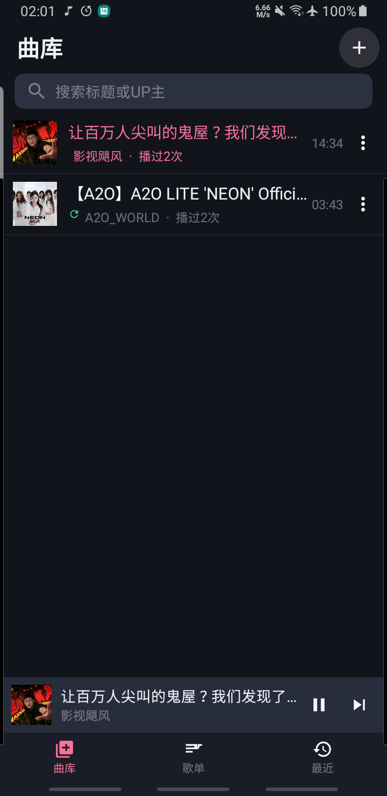
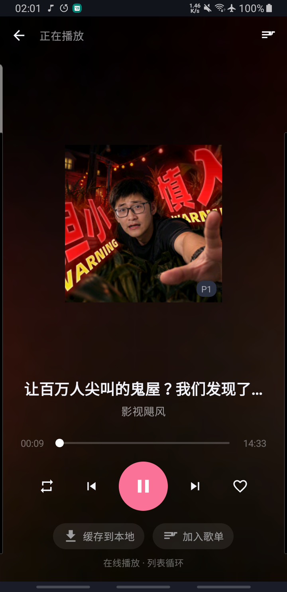
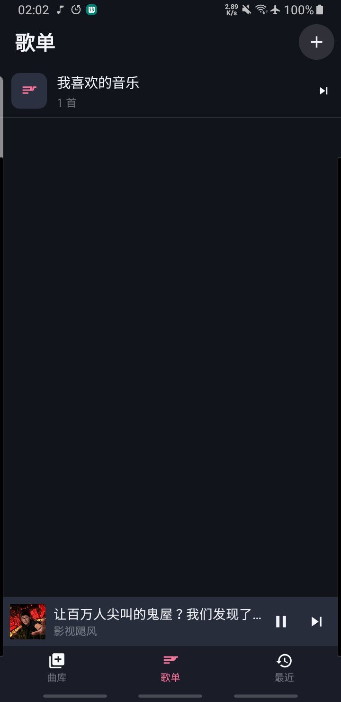
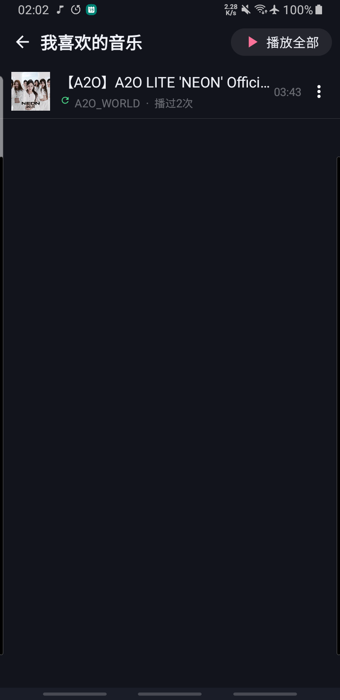
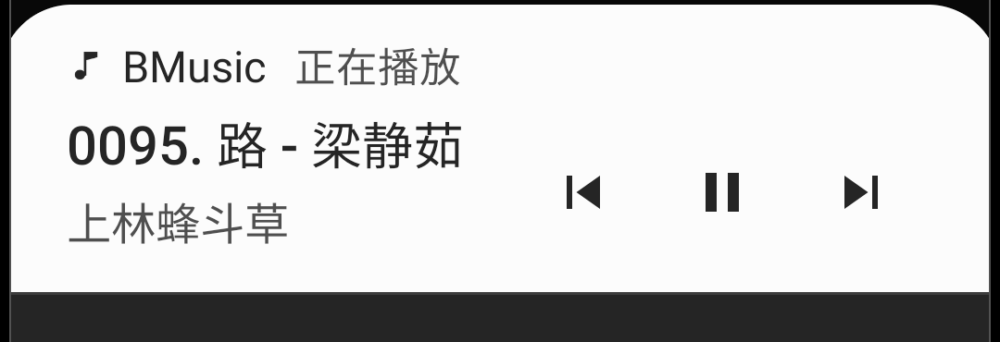
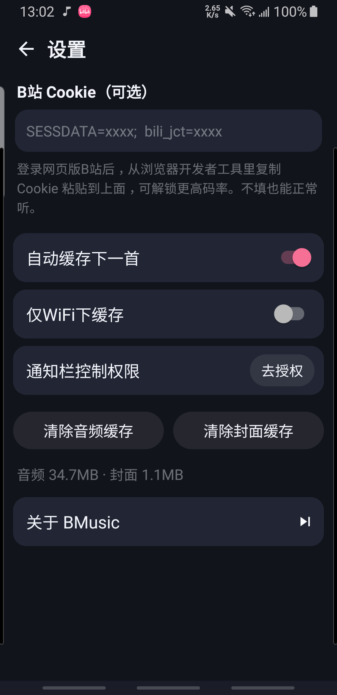
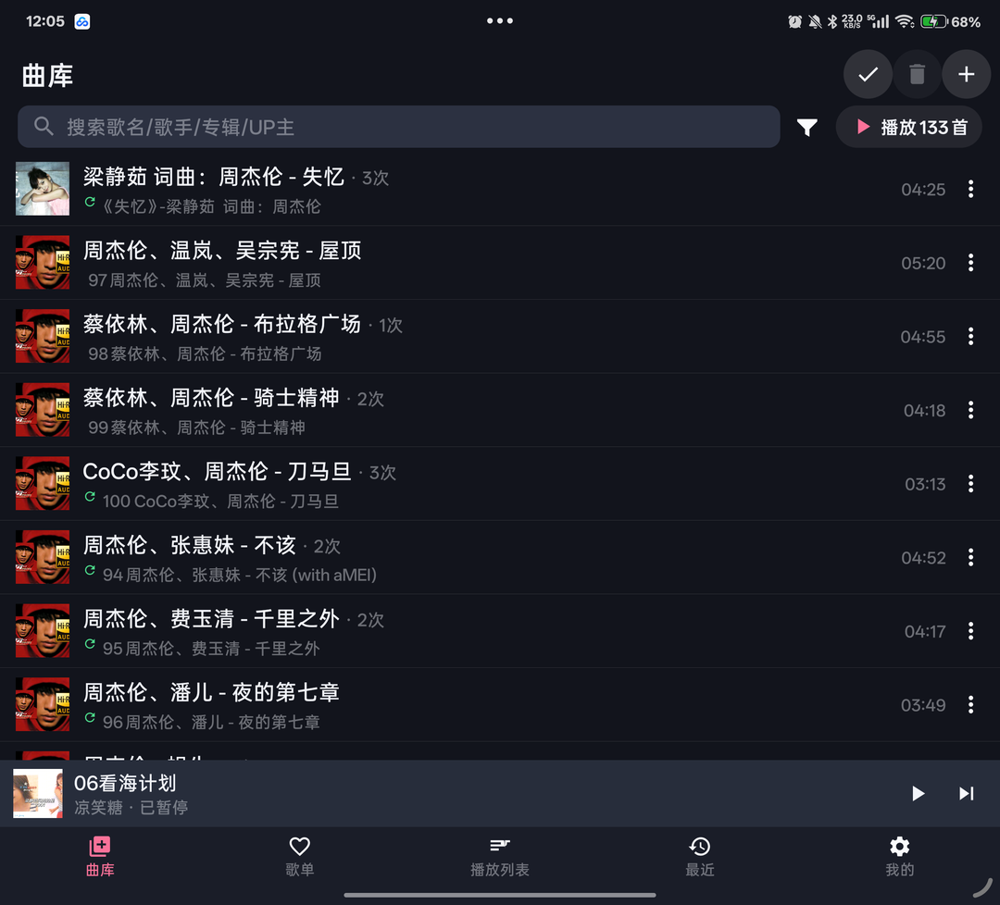
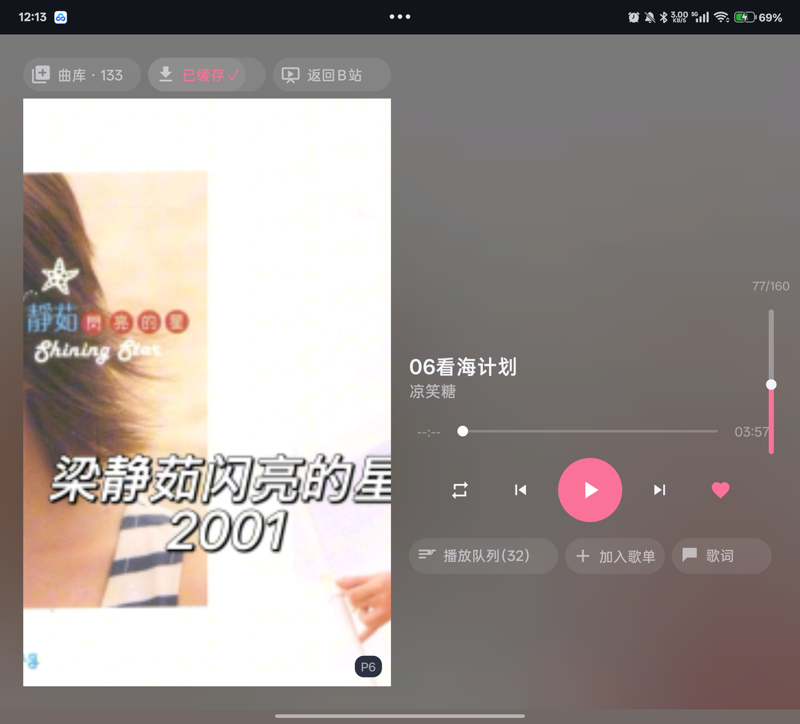

<div align="center">

# 🎵 BMusic

**把 B 站视频当音乐听。**

*分享链接 → 自动解析 → 后台播放 / 离线缓存 —— 像用音乐 App 一样用 B 站*

[](https://github.com/volcanochen/bmusic/releases/latest)
[](#-快速开始)
[](#%EF%B8%8F-技术栈)
[](#%EF%B8%8F-技术栈)
[](#-从源码构建)
[](#%EF%B8%8F-免责声明)

**[⬇️ 下载最新版](https://github.com/volcanochen/bmusic/releases/latest)** ·
**[📖 使用指南](#-使用指南)** ·
**[🛠️ 技术细节](docs/TECHNICAL.md)** ·
**[📋 需求全集](docs/requirements/README.md)**

</div>

---

BMusic 是一个**零第三方依赖、不依赖 Gradle** 的原生 Android 音乐播放器。它不下载视频，而是直接从 B 站取出**纯音频流**（DASH 音轨），配上完整的播放列表、后台播放、通知栏控制、离线缓存和精致播放页，让 B 站的视频内容也能被"当歌听"。

整个 App 从界面、网络、播放、缓存到数据库全部手写，APK 只有 **约 282 KB**——比很多应用的图标还小。

---

## 📸 界面预览

| 曲库 | 播放页 | 歌单 |
| :---: | :---: | :---: |
|  |  |  |
| 五页标签 · 缓存标记 · 迷你播放条 | 模糊封面背景 · 歌词逐行高亮 · 往复跑马灯 | 自建歌单 + 内置「我喜欢的音乐」 |

| 歌单详情 | 通知栏控制 | 设置 |
| :---: | :---: | :---: |
|  |  |  |
| 播放全部 / 排序 / 移除 | 上一首 · 暂停 · 下一首 | Cookie / 缓存策略 / 空间管理 |

### 📱 折叠屏 / 大屏自适应（OPPO Find N 系实测）

| 近方屏展开 · 曲库 | 近方屏展开 · 播放页 |
| :---: | :---: |
|  |  |
| 五页标签布局自动重排 | 播放页自动切「封面左 · 控制右」双栏 |

---

## ✨ 功能亮点

### 🎧 像音乐软件一样用 B 站
- **加歌方式齐全**：B 站「分享」面板直达 · 复制链接粘贴 · 扫码添加（内置摄像头取景）· 相册识别二维码（ZXing 内核）· 手动输入 BV 号；也支持系统「打开方式」分享给 BMusic
- **智能识别**：从任意文本提取 `BV 号` / `av 号` / `b23.tv 短链`，自动跟随短链跳转
- **多 P 精确**：按分 P 取对应音轨，列表直接显示「分P名 · 视频页标题」原始信息，来源一目了然
- **元信息补全**：从标题解析「歌名 - 歌手」，联网查 **QQ 音乐** 补真实专辑名；对不上宁可显示 Unknown，绝不张冠李戴
- **B站账号联动**：B 站 App 扫码授权登录 → 自动找到/创建名为 **bmusic** 的收藏夹 → 收藏的视频一键导入曲库；登录态同时降低取流风控概率

### 📼 离线缓存，断网也能听
- **一键缓存**：本地优先播放，不再依赖网络；断网自动跳过未缓存曲目
- **自动缓存下一首**：边听边备好（可限制仅 WiFi）
- **空间管理**：实时显示缓存占用，一键清理

### 🎵 完整的播放器体验
- **后台播放**：前台服务常驻，锁屏、切 App、息屏都不断
- **通知栏 / 耳机控制**：MediaStyle 通知条，蓝牙与线控按键可用
- **三种播放模式**：列表循环 · 单曲循环 · 随机播放
- **在线歌词**：自动匹配逐行高亮，识别不准可手动搜索切换
- **播放徽章**：每首歌记录播放次数，主标题后淡色小字「·N次」
- **往复跑马灯**：超长标题不出现「…」，缓慢地左右往返滚动

### 📚 图书馆式管理
- **五页标签**：曲库 / 歌单 / 播放列表 / 最近 / 我的，主界面一站式切换
- **播放列表**：多选（全选 / 反选）、删除所选、行菜单、正在播放高亮
- **歌单体系**：自建歌单 + 内置「我喜欢的音乐」，加入 / 移除 / 排序 / 重命名
- **播放历史**：最近播放 + 播放次数统计，按歌手 / 专辑筛选曲库

### 🧰 贴心小件
- **折叠屏 / 大屏自适应**：近方屏、分屏、浮窗、旋转全都不重建 Activity、自动重排布局（OPPO Find N 系真机实测）
- **桌面 2×2 小组件**：不进 App 直接上一首 / 播放暂停 / 下一首
- **曲库按链接去重**：同一个 BV 号 + 分 P 只留一首，导入 / 手动添加 / 恢复备份都不会重复，缓存与播放次数不丢；「我的」页可一键整理
- **数据备份 / 恢复**：按当前曲库歌曲导出 JSON（自动去重，不记录来源），恢复时同链接自动合并
- **应用内更新**：检查新版本并直接下载安装

---

## 🚀 快速开始

### 下载与安装

手机浏览器打开下面任意一个链接，下载后允许「安装未知来源应用」即可安装：

- **Releases 页面**（推荐，带版本说明与下载按钮）：<br>https://github.com/volcanochen/bmusic/releases/latest
- **固定直链**（始终指向最新版 APK）：<br>`https://raw.githubusercontent.com/volcanochen/bmusic/main/release/bmusic.apk`

连着电脑的话也可以直接 adb 安装：

```bash
adb install -r bmusic.apk
```

> APK 用调试证书签名；系统会提示"未知来源"，允许后继续。

### 更新

- **应用内更新（最省事）**：「我的」页 →「检查更新 / 下载最新版」，检测到新版本后直接下载并拉起系统安装器
- **手动覆盖安装**：按上面的方式重新下载最新 APK 直接安装即可，**无需卸载旧版**（签名一致，数据全部保留）

### 从源码构建

只需 **Android SDK（build-tools 34 + platform android-34）** 和 **JDK 17**，**不需要 Gradle、不需要联网拉依赖**：

```bash
git clone https://github.com/volcanochen/bmusic.git
cd bmusic
bash build.sh          # 产出 build/bmusic.apk
adb install -r build/bmusic.apk
```

`build.sh` 会自动生成 `debug.keystore` 并完成 **资源编译 → 链接 → 编 Java → 打 dex → 对齐 → 签名** 全流程。

---

## 📖 使用指南

| 步骤 | 操作 |
| --- | --- |
| **加歌 ①** | B 站 App 里点分享 → 选 **BMusic** |
| **加歌 ②** | 复制分享文案 → 曲库页点 `+` → 自动填入剪贴板 → 解析添加 |
| **加歌 ③** | 曲库页点 `+` →「扫码添加」摄像头对准二维码，或「从相册识别」 |
| **播放** | 点曲目即播；底部迷你条暂停 / 切歌；点迷你条进播放页 |
| **管理** | 曲目右侧 `⋮`：立即播放 / 加入队列 / 缓存 / 加歌单 / 返回 B 站 / 删除 |
| **队列** | 播放页底部「播放队列」→ 主界面播放列表页：全选 / 反选 / 删除所选 |
| **批量播放** | 曲库右上「播放 N 首」：当前筛选范围全部入队并播放 |
| **歌词** | 播放页「歌词」打开歌词面板，自动匹配，可手动搜索切换 |
| **离线** | 播放页「缓存到本地」，或设置里开「自动缓存下一首」 |
| **小组件** | 桌面长按 → 小组件 → BMusic：左「上一首」/ 中「播放暂停」/ 右「下一首」，左右都是大点击热区（点文字或空白处进播放页） |
| **中断续播** | 切去 B 站/视频 App 被抢走音频焦点后暂停，切回来自动从断点继续（服务被回收也会记住进度） |
| **账号登录** | 「我的」→「B站账号」→ 点「打开 B 站 App 授权登录」→ 在 B 站 App 点「确认」（无需密码、无需第二台设备）；二维码仅作备用 |
| **收藏夹导入** | 在 B 站 App 把视频/合集收藏进「bmusic」→ 曲库右上「+」→「从 B 站收藏夹导入（bmusic）」直接导入；账号页也有导入按钮 |

### 关于音质与 Cookie

不填 Cookie 也能正常取流（通常 64K / 132K）。解锁 **192K** 有两种方式：

1. **推荐**：「我的」或「设置」→「B站账号」→ 用 B 站 App 一键授权，凭证自动保存；登录态还能让取流更稳定
2. 手动：登录 bilibili.com → F12 → Network → 复制请求 Cookie → 粘贴到 BMusic 设置页

登录后账号页会自动查找 **bmusic** 收藏夹，没有就创建一个；之后在 B 站 App 里收藏视频，回到 BMusic 一键导入即可（合集展开全部视频，多 P 视频全部分 P 导入）。

---

## ❓ 常见问题

<details>
<summary><b>为什么不直接下载视频？</b></summary>

音乐播放只需要音轨。BMusic 走 `playurl` 的 DASH 接口只取音频流，体积小、起播快，也避免了视频转码。
</details>

<details>
<summary><b>会占用很多空间吗？</b></summary>

音频按 64K～192K 码率缓存，一首 5 分钟的歌约 **3～7 MB**，比视频小一个数量级。
</details>

<details>
<summary><b>为什么有时提示「请求被拦截(-412)」？</b></summary>

这是 B 站 Web 风控。v1.0.25 起会自动重建设备身份（buvid3/buvid4 + bili_ticket）、重取 wbi 签名、换成视频页 Referer 后退避重试，并在 `wbi/playurl → playurl → durl` 三级端点间降级、下载失败时切换备用 CDN。若仍被拦截，在「B站账号」里一键授权登录（登录态 + 稳定设备指纹）通常能解决；也可稍后再试。
</details>

<details>
<summary><b>支持后台 / 锁屏吗？</b></summary>

支持。播放走前台服务，息屏、锁屏、后台运行都不中断；进程被杀后重新打开也会恢复队列。
</details>

<details>
<summary><b>为什么叫"零依赖"？</b></summary>

连二维码解码都是把 ZXing 的 QR 解码子集（50 个文件）直接 vendored 进源码树——不引入任何 jar / aar / Gradle 依赖，构建只靠 Android SDK 工具链。
</details>

---

## 🛠️ 技术栈

| 方面 | 方案 |
| --- | --- |
| 语言 / 环境 | Java 8 · minSdk 24（Android 7.0）· targetSdk 34 |
| 界面 | 原生 View + XML 布局（无任何 UI 库），自适应分屏 / 浮窗 / 折叠屏 |
| 网络 | `HttpURLConnection` + 手写 **wbi 请求签名**（mixin key 混淆表 + MD5）、持久化设备指纹、`bili_ticket` 设备票据、风控自动重试 |
| 取流 | `x/player/wbi/playurl` → `x/player/playurl` → `fnval=0` durl 三级降级，按音质分级取音轨（30280 > 30232 > 30216），备用 CDN 自动切换 |
| 登录 | B 站网页二维码授权；`bilibili://forward?-Btarget=` 把授权链接交给 B 站 App 内 WebView 一键确认，2s 轮询 `qrcode/poll` 收结果，从 `Set-Cookie` 提取 `SESSDATA / bili_jct / DedeUserID` |
| 收藏夹 | `x/v3/fav/folder/*` 查找/创建 `bmusic`，`x/v3/fav/resource/list` 分页读取并导入曲库 |
| 播放 | `MediaPlayer` + `MediaSession` + `Notification.MediaStyle` |
| 元信息 | 本地规则解析标题 + QQ 音乐搜索补专辑（门控：歌名一致 + 歌手匹配） |
| 扫码 | ZXing 3.3.3 QR **编码 + 解码**子集（Apache 2.0，vendored，无 jar/aar） |
| 数据 | `SQLiteOpenHelper`（tracks / playlists / pl_tracks / history） |
| 构建 | `aapt2 → javac → d8 → zipalign → apksigner` 纯脚本流水线 |

> 想深入了解 B 站接口调用、wbi 签名、DASH 取流、缓存优先级、无 Gradle 构建流水线等实现细节，请看 **[技术文档 →](docs/TECHNICAL.md)**；每个版本的功能清单与实现思路见 **[需求全集 →](docs/requirements/README.md)**。

---

## ⚖️ 免责声明

- 本项目为**个人学习与技术研究**用途，仅用于在**自己的设备上离线收听已公开的内容**。
- 所有音频内容的**版权归哔哩哔哩及原 UP 主所有**，请勿用于分发、转载或任何商业用途。
- 请遵守 B 站用户协议与相关法律法规，合理使用。

---

<div align="center">
  <sub>Made with ☕ and no Gradle · <a href="https://github.com/volcanochen/bmusic/releases">最新版本</a></sub><br/>
  <sub>如果对你有帮助，欢迎点个 ⭐ Star</sub>
</div>
